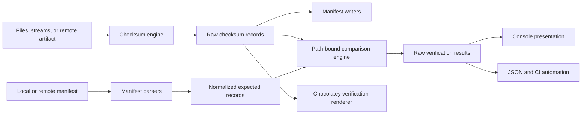

# csverify Pending Development Tracker

This tracker defines the pending work required to correct path-bound verification and evolve csverify into a cross-platform checksum, manifest, release-artifact, and Chocolatey verification module.

## Tracker Contract

### Conceptual

Work is grouped as epics and ordered by dependency and risk. The first release must correct the reported integrity defect before new network or format capabilities are added.

### Strict Reference

| Marker | Meaning |
| --- | --- |
| `[ ]` | Pending |
| `[x]` | Completed and verified |
| `P0` | Release blocker or integrity defect |
| `P1` | Required foundation capability |
| `P2` | Planned interoperability capability |
| `P3` | Deferred hardening or extension |

Task completion requires its acceptance criteria, relevant Pester coverage, and documentation updates. Code completion alone does not close a task.

## Review Outcome

### Conceptual

The fix recommended in `issue.md` is correct: a verification record must be selected by normalized relative path, and the calculated hash must be compared only with the expected hash attached to that path. Hashes are content properties and are not unique record identifiers.

The dictionary implementation should be adopted with the following changes:

- Build both expected-path and current-path indexes.
- Reject duplicate normalized paths in either input.
- Compare both path sets so missing and unexpected files are reported.
- Keep parsed and returned values free of ANSI escape sequences.
- Treat every non-verified result as a verification failure when build-gating behavior is requested.
- Preserve current public commands through compatibility wrappers while the internal engine and public API are replaced.

The reported defect is not isolated. The current implementation also has these release-relevant gaps:

| Finding | Evidence | Impact | Priority |
| --- | --- | --- | --- |
| Duplicate-content false failures | `Test-Verification` performs a global hash lookup after its path lookup. | Valid packages fail when different paths contain identical bytes. | P0 |
| Missing files are invisible | Verification iterates only current filesystem records. | Deleted files can pass verification. | P0 |
| Unexpected files do not fail | Failure count matches only the colored word `Failed`. | Added files can pass verification. | P0 |
| Machine data contains ANSI | `Read-CheckSum` colors `Size` and `Path`. | Comparisons, JSON, logs, and downstream automation receive presentation data. | P0 |
| Formatted output is returned | `Test-Verification` returns `Format-Table` output. | Callers cannot reliably inspect or serialize results. | P0 |
| Verified path property is misspelled | Verified records use `sath`; other records use `path`. | Output schema changes by status. | P0 |
| Import has an undeclared runtime dependency | Root formatting scriptblocks call `csole`, but the command is neither shipped nor declared. | A clean import succeeds, but ordinary commands fail at runtime. | P0 |
| Error handling can continue after failure | `Test-Verification` catches source errors without terminating. | A failed setup can continue with null or incomplete state. | P0 |
| Parser accepts malformed data | Records are split repeatedly on `|` without field, hash, or path validation. | Corrupt or hostile manifests can create partial records or wrong paths. | P0 |
| Size is lossy presentation text | Byte length is converted to a culture-sensitive rounded string. | Size cannot be used as exact integrity metadata. | P1 |
| Enumeration is not deterministic enough | Recursive cmdlets, broad exclusions, and unspecified descending sort are used. | Manifests can vary by platform, culture, or workspace content. | P1 |
| Tests are not isolated | Tests change process location without guaranteed restoration and assert types rather than behavior. | One failure cascades into later tests; integrity cases are untested. | P0 |
| Original test baseline was red | The initial local Pester run on 2026-08-05 returned 0 passed and 4 failed; the first failure was missing `csole`. The Public/Private refactor replaced this suite and restored a passing local baseline. | Historical defect retained for regression context. | Resolved locally |

### Strict Reference

Non-negotiable invariants:

1. Normalized relative path is record identity for directory manifests.
2. Duplicate hashes at different paths are valid.
3. Duplicate normalized paths are invalid.
4. Hash and byte length remain raw values until presentation.
5. A checksum obtained through the same compromised channel as an artifact proves consistency, not publisher authenticity.
6. Remote verification must complete before a downloaded artifact is moved to its requested destination.

## Delivery Sequence

| Release target | Scope | Exit condition |
| --- | --- | --- |
| `0.3.9` hotfix | Epic 0 and minimum Epic 1 dependency cleanup | The reported duplicate-content case and all P0 integrity states are covered and passing. |
| `0.4.0` foundation | Epics 1-4 | Raw engine, versioned manifests, local verification, and compatibility layer are stable. |
| `0.5.0` remote | Epic 5 | Generic HTTPS artifact plus checksum verification is stable. |
| `0.6.0` packaging | Epic 6 | Chocolatey generation and release-provider adapters are stable. |
| `1.0.0` contract | Epic 7 and selected Epic 8 work | API, schema, compatibility, documentation, and CI contracts are declared stable. |

## Epic 0: Correct the Path-Bound Verification Defect

- **Priority:** P0
- **Depends on:** None
**Outcome:** Valid duplicate-content files pass, while modified, missing, unexpected, and malformed records fail deterministically.

### Tasks

- [ ] **E0-T01 — Preserve the reported reproduction as a regression fixture.**
  - Create two-path and three-path duplicate-content fixtures.
  - Include the same basename in different directories with different content.
  - Record the original failing behavior without relying on console color text.
- [ ] **E0-T02 — Introduce one canonical relative-path normalizer.**
  - Convert directory separators to `/` for manifest identity.
  - Remove only the accepted legacy `./` or `.\` prefix.
  - Reject empty, rooted, drive-qualified, UNC, traversal, NUL, and control-character paths.
  - Add an explicit `Auto`, `Sensitive`, and `Insensitive` path-case policy.
- [x] **E0-T03 — Index expected records by normalized path.**
  - Use `Dictionary[string, object]` with the selected comparer.
  - Reject duplicate normalized paths instead of overwriting records.
- [x] **E0-T04 — Index current records by normalized path.**
  - Reject filesystem enumeration collisions after normalization.
  - Retain original display path separately from normalized identity.
- [x] **E0-T05 — Replace the global hash lookup with a same-record comparison.**
  - Compare actual hash only with the expected record resolved from the same path.
  - Use ordinal, case-insensitive hexadecimal comparison after validating and normalizing hash casing.
- [x] **E0-T06 — Complete the two-way path-set comparison.**
  - Emit `Unexpected` for current paths absent from the manifest.
  - Emit `Missing` for manifest paths absent from the current filesystem.
  - Emit `HashMismatch` for changed content.
- [ ] **E0-T07 — Return a consistent raw result schema.**
  - Required properties: `Status`, `Path`, `Algorithm`, `ExpectedHash`, `ActualHash`, `ExpectedBytes`, `ActualBytes`, and `Message`.
  - Remove `Format-Table` and all ANSI sequences from command output.
  - Correct `sath` to `Path` in every state.
- [ ] **E0-T08 — Correct failure accounting and error semantics.**
  - Count every result whose status is not `Verified`.
  - Distinguish verification mismatches from operational errors such as unreadable files or invalid manifests.
  - Preserve build-gating behavior through an explicit compatibility or `-FailOnMismatch` path.
- [ ] **E0-T09 — Harden the legacy parser enough for the hotfix.**
  - Require exactly three legacy fields.
  - Validate SHA-256 as 64 hexadecimal characters.
  - Validate exact byte length when available; retain legacy display-size text only as compatibility metadata.
  - Reject duplicate paths and malformed lines with line-numbered errors.
- [ ] **E0-T10 — Verify the GLVigor case.**
  - Validate all 192 records.
  - Confirm all nine duplicate-content groups produce 18 `Verified` results rather than false failures.
  - Confirm one controlled modification, addition, and deletion each fail.

### Acceptance Criteria

- [ ] Two or more paths may share one hash and all verify independently.
- [ ] Missing, unexpected, modified, and malformed records cannot produce overall success.
- [ ] Results serialize with `ConvertTo-Json` without ANSI or PowerShell formatting metadata.
- [ ] Pester tests cover every regression case listed in `issue.md`.
- [ ] A clean PowerShell process can import and execute the four legacy commands without external formatting modules.

## Epic 1: Establish the Module Architecture and Compatibility Boundary

- **Priority:** P1
- **Depends on:** Epic 0 behavioral contract
**Outcome:** The module has an explicit public/private architecture and no undeclared runtime dependencies.

### Tasks

- [x] **E1-T01 — Replace nested `.psm1` command files with a root loader and file-per-cmdlet layout.**
  - Use `Public`, `Private`, and optional `Classes` directories.
  - Dot-source files in deterministic order from `csverify.psm1`.
  - Keep `Export-ModuleMember` and `FunctionsToExport` explicit and identical.
- [x] **E1-T02 — Enable strict execution in module scope.**
  - Account for `Set-StrictMode -Version Latest` and `$ErrorActionPreference = 'Stop'`.
  - Do not mutate caller global preferences.
- [x] **E1-T03 — Remove `$global:_csverify`.**
  - Keep state in module scope or eliminate it.
  - Replace stored formatting scriptblocks with private functions where presentation is retained.
- [x] **E1-T04 — Remove checksum-engine coupling to `csole`, `Get-ColorTune`, and `cfbytes`.**
  - No presentation dependency may be required to hash, parse, or compare.
  - Implement byte formatting as a private display-only helper if still required.
- [ ] **E1-T05 — Define the compatibility layer.**
  - Keep `New-CheckSum`, `Read-CheckSum`, `New-VerificationFile`, and `Test-Verification` as wrappers through the `0.x` line.
  - Map legacy parameters and output intentionally.
  - Emit deprecation warnings only after replacement commands and migration documentation exist.
- [x] **E1-T06 — Correct manifest metadata.**
  - Align description, Chocolatey description, URLs, release notes, tags, exported functions, and required PowerShell version with actual behavior.
  - Remove unrelated descriptions such as file/folder searching.
- [ ] **E1-T07 — Define stable types.**
  - Add typed checksum record, verification result, and verification summary contracts or stable PowerShell type names.
  - Avoid classes that prevent safe module reload during development unless the tradeoff is documented.

### Acceptance Criteria

- [ ] `Import-Module ./csverify.psd1 -Force` succeeds in a clean PowerShell 7 process on Windows, Linux, and macOS.
- [ ] Every exported command resolves to one public source file.
- [ ] No public command requires an undeclared command, global variable, or interactive host.
- [ ] Legacy command behavior is covered by compatibility tests.

## Epic 2: Build the Generic Checksum Engine

- **Priority:** P1
- **Depends on:** Epic 1
**Outcome:** Files, streams, strings, and directory trees produce deterministic raw checksum records.

### Tasks

- [ ] **E2-T01 — Implement streaming checksum calculation.**
  - Use disposable .NET file streams and cryptographic hash implementations.
  - Do not load large files into memory.
  - Open files with explicit read/share behavior and dispose streams in `finally` blocks.
- [ ] **E2-T02 — Support secure algorithms.**
  - Default to SHA-256.
  - Support SHA-384 and SHA-512 for generation and verification.
  - Permit MD5 and SHA-1 only behind an explicit legacy-compatibility switch and emit a security warning.
- [ ] **E2-T03 — Support core input modes.**
  - Literal file path, pipeline file input, input stream, literal string, byte array, and directory root.
  - Ensure string hashing requires an explicit encoding with UTF-8 as the documented default.
- [ ] **E2-T04 — Produce exact metadata.**
  - Use `Int64` byte length.
  - Store uppercase or lowercase hexadecimal according to one invariant; compare without case sensitivity.
  - Record algorithm explicitly rather than inferring it from hash length after parsing.
- [ ] **E2-T05 — Make directory enumeration deterministic.**
  - Sort by normalized ordinal relative path.
  - Include hidden files by default.
  - Exclude the output manifest itself deterministically.
  - Provide repeatable include and exclude patterns; do not silently treat `.git` as universally excluded.
- [ ] **E2-T06 — Define link and special-file policy.**
  - Default to regular files only.
  - Do not follow symbolic links outside the selected root.
  - Add explicit link behavior only after cross-platform tests exist.
- [ ] **E2-T07 — Add optional bounded concurrency.**
  - Benchmark before enabling parallel hashing.
  - Preserve deterministic output order.
  - Default throttle based on measured I/O behavior, not CPU count alone.

### Acceptance Criteria

- [ ] The same tree produces byte-identical records across repeated runs.
- [ ] Large-file hashing has bounded memory use.
- [ ] Empty, one-byte, Unicode-name, space-containing, and read-only files are covered.
- [ ] Algorithm and byte-count metadata remain raw and culture-independent.

## Epic 3: Add Versioned and Interoperable Manifest Formats

- **Priority:** P1
- **Depends on:** Epic 2
**Outcome:** csverify can read and write its own lossless format and consume common release checksum formats.

### Tasks

- [ ] **E3-T01 — Define `csverify-manifest-v1`.**
  - Use a versioned UTF-8 JSON schema with algorithm, hexadecimal hash, normalized path, and exact byte length.
  - Include generator version and creation metadata only where it does not break reproducibility.
  - Publish a JSON Schema and representative fixtures.
- [ ] **E3-T02 — Implement GNU untagged checksum format.**
  - Parse and write `digest`, mode marker, and filename.
  - Support the GNU escaping rules for backslash, newline, and carriage return.
  - Support common names including `SHA256SUMS`, `SHA512SUMS`, `checksums.txt`, and `checksums.sha256` without relying on filename alone for trust.
- [ ] **E3-T03 — Implement BSD tagged checksum format.**
  - Parse and write records such as `SHA256 (name) = digest`.
  - Reject unsupported or mixed algorithms unless explicitly allowed.
- [ ] **E3-T04 — Implement single-artifact sidecar format.**
  - Support raw digest files such as `artifact.zip.sha256` only when the target artifact is supplied explicitly.
  - Reject ambiguous raw-digest manifests containing multiple candidate artifacts.
- [ ] **E3-T05 — Preserve the current csverify/Chocolatey embedded table as `LegacyVerification`.**
  - Read existing `size | hash | path` files.
  - Document that paths containing `|`, newline, or carriage return are not representable and must use the JSON or GNU format.
  - Stop using rounded display size as integrity metadata.
- [ ] **E3-T06 — Implement strict format selection.**
  - Provide `-Format Auto` only when detection is unambiguous.
  - Return a terminating parse error for malformed, mixed, or unknown input.
  - Include source and line number in parser diagnostics.
- [ ] **E3-T07 — Implement atomic manifest output.**
  - Write to a same-directory temporary file, flush, and replace the destination.
  - Support `ShouldProcess` and `-WhatIf` for file creation or replacement.
  - Use deterministic UTF-8 and newline settings per format.
- [ ] **E3-T08 — Add round-trip and external-compatibility tests.**
  - Validate generated GNU files with `sha256sum --check` on Linux CI.
  - Validate imported GNU and BSD golden fixtures.
  - Validate JSON schema and byte-for-byte deterministic output.

### Acceptance Criteria

- [ ] Each supported format has strict parser, writer, fixture, and negative tests.
- [ ] Auto-detection never guesses between two valid interpretations.
- [ ] Paths with spaces round-trip in every applicable format.
- [ ] The v1 JSON manifest represents all supported paths and exact sizes without presentation loss.

## Epic 4: Provide Composable Local Verification

- **Priority:** P1
- **Depends on:** Epics 2-3
**Outcome:** Callers can verify one artifact or an entire tree and consume structured results in scripts and CI.

### Tasks

- [ ] **E4-T01 — Implement single-file verification.**
  - Accept expected hash directly or select it from a manifest by exact artifact name.
  - Return one raw verification result.
- [ ] **E4-T02 — Implement directory-manifest verification.**
  - Use the Epic 0 path-bound comparison engine.
  - Support `Verified`, `HashMismatch`, `Missing`, and `Unexpected` states.
- [ ] **E4-T03 — Add result and summary modes.**
  - Stream detailed result records.
  - Provide a summary containing total, verified, mismatch, missing, unexpected, duration, and overall success.
  - Keep display formatting opt-in through a format view or caller-side `Format-Table`.
- [ ] **E4-T04 — Define mismatch behavior.**
  - Verification mismatches return results and set `IsSuccess = $false`.
  - `-FailOnMismatch` emits a terminating error after all requested records are evaluated.
  - Invalid input, unreadable files, and parser faults remain operational errors.
- [ ] **E4-T05 — Prevent path escape.**
  - Resolve every manifest path beneath the verification root.
  - Reject traversal, rooted paths, alternate data streams where applicable, and links that escape the root.
- [ ] **E4-T06 — Add TOCTOU diagnostics.**
  - Capture file length and last-write metadata before and after hashing.
  - Report a changed-during-read operational failure rather than a misleading mismatch.

### Acceptance Criteria

- [ ] Commands work in headless hosts and pipelines.
- [ ] Mismatch results are inspectable without parsing text.
- [ ] Build systems can select fail-fast or complete-report behavior explicitly.
- [ ] Hostile manifest paths cannot read files outside the chosen root.

## Epic 5: Verify Remote Release Artifacts and Checksum Assets

- **Priority:** P2
- **Depends on:** Epics 2-4
**Outcome:** A caller can download or stream an artifact and verify it against a remote `checksums.txt`, `SHA256SUMS`, sidecar digest, or csverify manifest.

### Tasks

- [ ] **E5-T01 — Implement generic URI-pair verification first.**
  - Accept explicit artifact URI and checksum-manifest URI.
  - Default to HTTPS and require an explicit insecure-transport override for HTTP.
  - Select the checksum record by exact normalized asset filename.
- [ ] **E5-T02 — Implement safe HTTP behavior.**
  - Use `HttpClient` with explicit connect/request timeouts, redirect limits, cancellation, and disposal ownership.
  - Reject HTTPS-to-HTTP redirect downgrade by default.
  - Apply maximum manifest and artifact sizes.
  - Support proxy configuration without logging secrets.
- [ ] **E5-T03 — Verify before publishing the download.**
  - Stream into a unique temporary file while hashing.
  - On success, move atomically to the requested destination.
  - On failure or cancellation, remove the temporary file in `finally`.
  - Provide `-KeepFailedDownload` only as an explicit diagnostic option.
- [ ] **E5-T04 — Support authenticated private assets.**
  - Accept provider tokens or authentication callbacks without embedding credentials in URIs.
  - Redact authorization headers and signed query values from verbose and error output.
- [ ] **E5-T05 — Add GitLab release discovery.**
  - Resolve a release by tag or the latest-release permalink.
  - Enumerate release asset links and select artifact/checksum assets by exact name or explicit pattern.
  - Reject zero or multiple matches.
- [ ] **E5-T06 — Add GitHub release discovery.**
  - Resolve latest or tagged releases through the versioned REST API.
  - Handle release asset binary responses and redirects.
  - Support unauthenticated public and token-authenticated private repositories.
- [ ] **E5-T07 — Keep providers behind adapters.**
  - Generic URI behavior remains independent of GitHub or GitLab.
  - Provider-specific response models do not leak into checksum records.
  - Add future provider registration only after two built-in adapters validate the contract.
- [ ] **E5-T08 — Add deterministic network tests.**
  - Use a local test server for redirects, truncation, timeout, oversized response, cancellation, and auth redaction.
  - Mock provider APIs from recorded minimal fixtures; do not require live public services for unit tests.

### Acceptance Criteria

- [ ] A valid remote artifact is not exposed at the final path until verification succeeds.
- [ ] A mismatch, timeout, truncated response, or ambiguous asset selection leaves no unrequested final file.
- [ ] Secrets do not appear in output, error records, or test logs.
- [ ] Generic URI, GitLab, and GitHub paths produce the same verification result contract.

## Epic 6: Generate Chocolatey `VERIFICATION.txt` and Release Metadata

- **Priority:** P2
- **Depends on:** Epics 3-5
**Outcome:** csverify generates human-readable Chocolatey verification guidance separately from machine-readable checksum manifests.

### Tasks

- [ ] **E6-T01 — Define a Chocolatey verification input model.**
  - Package name and version.
  - Embedded binary path.
  - Official download or release URL.
  - Algorithm and expected checksum.
  - Reproducible verification instructions and maintainer notes.
- [ ] **E6-T02 — Implement a canonical Chocolatey renderer.**
  - Generate `tools/VERIFICATION.txt` by default.
  - Support `VERIFICATION`, `VERIFICATION.txt`, or `VERIFICATION.md` only where requested; emit the canonical `.txt` name by default.
  - Keep human instructions readable without requiring csverify to understand them as a manifest.
- [ ] **E6-T03 — Support multiple embedded binaries.**
  - Map each package path to its official source and checksum.
  - Reject incomplete source/checksum mappings.
- [ ] **E6-T04 — Add release-to-Chocolatey workflow.**
  - Resolve a tagged GitLab/GitHub release asset.
  - Verify the upstream asset checksum.
  - Generate Chocolatey verification guidance from the verified metadata.
- [ ] **E6-T05 — Add template and moderation fixtures.**
  - Compare output with current `choco new` conventions.
  - Cover locally built binaries, vendor binaries, and multiple artifacts.
- [ ] **E6-T06 — Integrate with automator-devops.**
  - Make checksum-manifest and Chocolatey verification generation explicit build steps.
  - Publish checksum assets beside release artifacts.
  - Verify produced packages before upload.

### Acceptance Criteria

- [ ] The generated file explains how a moderator can verify each included binary against an official location.
- [ ] Chocolatey prose and machine manifests are separate artifacts with separate parsers/renderers.
- [ ] Build automation can generate both without interactive prompts.

## Epic 7: Establish the Quality, CI, Documentation, and Release Gates

- **Priority:** P1 through P2
- **Depends on:** Applies throughout all epics
**Outcome:** csverify is safe to reuse as a foundation dependency across projects.

### Tasks

- [x] **E7-T01 — Replace the current Pester suite.**
  - Use `TestDrive:` and `BeforeAll`/`AfterAll` isolation.
  - Never depend on mutable repository fixtures for generated output.
  - Never change process location without `Push-Location`/`Pop-Location` in `try/finally`.
  - Assert content, state, error IDs, and schemas rather than only `.GetType().Name`.
- [ ] **E7-T02 — Implement the full regression matrix.**
  - Duplicate content, missing, unexpected, modified, empty, same basename, spaces, Unicode, case policy, separator conversion, malformed lines, duplicate paths, inaccessible files, and JSON serialization.
- [ ] **E7-T03 — Add a platform test matrix.**
  - PowerShell 7 on Windows, Linux, and macOS.
  - Cross-generate and cross-verify manifests between Windows and Linux fixtures.
- [ ] **E7-T04 — Enforce coverage and analysis.**
  - Require at least 90% coverage for public commands and integrity-critical private helpers.
  - Run PSScriptAnalyzer against owned source while excluding `dist`, vendored automation, and immutable fixtures.
  - Treat selected correctness and security rules as CI failures.
- [ ] **E7-T05 — Add performance baselines.**
  - Measure import time, 10,000-file enumeration, large-file streaming, parser throughput, and optional parallel hashing.
  - Record memory peak and deterministic-output validation.
- [ ] **E7-T06 — Rewrite module documentation.**
  - Installation, trust model, local verification, remote verification, manifest formats, Chocolatey generation, migration, and API reference.
  - Every example must run in a clean PowerShell 7 process.
- [ ] **E7-T07 — Maintain release records.**
  - Populate `CHANGELOG.md` with issue impact and compatibility notes.
  - Generate and publish checksums for every release artifact.
  - Verify release artifacts in CI before deployment.
- [ ] **E7-T08 — Add public API contract tests.**
  - Manifest exports match root exports.
  - Parameter sets, aliases, output type names, status values, and error IDs remain stable within SemVer rules.
- [ ] **E7-T09 — Validate the local and container build paths.**
  - Run Pester, analysis, build, packaging, and cleanup through `localbuilder.ps1`.
  - Run the same gates in the automator container before release.

### Acceptance Criteria

- [ ] CI cannot publish when tests, analysis gates, generated checksums, or package self-verification fail.
- [ ] Coverage is at least 90% for the declared scope.
- [ ] Documentation examples are executed as tests.
- [ ] The release contains machine-readable checksums and the Chocolatey package contains required verification guidance.

## Epic 8: Extend Integrity into Authenticity and Provenance

- **Priority:** P3
- **Depends on:** Epics 3-7
**Outcome:** Callers can establish who published checksum metadata, not only whether artifact bytes match it.

### Tasks

- [ ] **E8-T01 — Add detached-signature verification adapters.**
  - Evaluate OpenPGP, minisign, and platform Authenticode as separate adapters.
  - Require explicit trusted key or certificate identity.
  - Never treat a successfully parsed signature as trusted without identity validation.
- [ ] **E8-T02 — Verify signed checksum manifests before artifact verification.**
  - Make signature status part of the result summary.
  - Fail closed when signature verification was requested.
- [ ] **E8-T03 — Add provenance metadata hooks.**
  - Attach release tag, commit, provider, asset identifier, and source URI to verification summaries.
  - Keep provenance metadata separate from the content hash itself.
- [ ] **E8-T04 — Evaluate SBOM and build-attestation integration.**
  - Treat these as integrations rather than checksum-manifest replacements.
  - Do not expand the core module until a concrete consumer workflow is defined.

### Acceptance Criteria

- [ ] Documentation states whether a workflow proves integrity, authenticity, or both.
- [ ] Trust roots are caller-controlled and never downloaded implicitly from the same untrusted release.
- [ ] Signature or provenance failures have stable machine-readable error identifiers.

## Cross-Epic Security Requirements

### Conceptual

Checksum correctness is necessary but insufficient for supply-chain trust. The module must make channel and identity assumptions explicit.

### Strict Reference

| Requirement | Default |
| --- | --- |
| Generation algorithm | SHA-256 |
| Allowed secure generation algorithms | SHA-256, SHA-384, SHA-512 |
| MD5/SHA-1 generation | Rejected unless explicit legacy override is present |
| Remote transport | HTTPS |
| Redirect downgrade | Rejected |
| Manifest parsing | Strict and bounded |
| Manifest path traversal | Rejected |
| Duplicate normalized path | Rejected |
| Final download placement | After successful verification |
| Temporary-file cleanup | Required in `finally` |
| Console color in data objects | Prohibited |
| Token/header logging | Prohibited |
| Signature trust | Explicit caller-provided identity |

## Decisions Recorded

| ID | Decision | Rationale |
| --- | --- | --- |
| ADR-001 | Approve the `issue.md` path-keyed dictionary fix with a second current-path index and two-way comparison. | One expected index fixes duplicate hashes; two indexes also make missing and unexpected states complete and efficient. |
| ADR-002 | Keep hashes as record properties, never identity keys. | Identical bytes at different paths are valid. |
| ADR-003 | Separate raw engine data from presentation. | Objects must remain comparable, serializable, testable, and host-independent. |
| ADR-004 | Separate Chocolatey verification prose from machine checksum manifests. | They serve different consumers and have different validation rules. |
| ADR-005 | Add generic URI verification before provider adapters. | GitLab and GitHub should resolve assets, not define checksum behavior. |
| ADR-006 | Use a versioned lossless JSON format as the csverify native manifest. | The legacy pipe table cannot represent all paths or exact byte metadata safely. |
| ADR-007 | Preserve legacy commands as wrappers during the `0.x` migration. | csverify is already a foundation dependency in other builds. |
| ADR-008 | Verification mismatches are data by default; operational failures are errors. | Callers need complete reports, while CI can opt into terminating build-gate behavior. |
| ADR-009 | SHA-256 is the minimum default for interoperable new workflows. | PowerShell defaults to SHA-256, and current security guidance rejects MD5/SHA-1 for tamper-resistant uses. |

## External Interoperability References

- [GNU Coreutils checksum output and check formats](https://www.gnu.org/software/coreutils/manual/coreutils.html)
- [PowerShell `Get-FileHash`](https://learn.microsoft.com/en-us/powershell/module/microsoft.powershell.utility/get-filehash?view=powershell-7.5)
- [NIST policy on hash functions](https://csrc.nist.gov/Projects/Hash-Functions/NIST-Policy-on-Hash-Functions)
- [GitLab Releases API](https://docs.gitlab.com/api/releases/)
- [GitHub release asset API](https://docs.github.com/en/rest/releases/assets)
- [Chocolatey `VERIFICATION.txt` package-validator rule](https://docs.chocolatey.org/en-us/community-repository/moderation/package-validator/rules/cpmr0006/)

## Proposed API Reference

The names below are the target API for design and implementation tasks; final names must be confirmed by API contract tests before `1.0.0`.

| Command | Primary parameter sets | Output | Purpose | Legacy mapping |
| --- | --- | --- | --- | --- |
| `Get-CsChecksum` | `-LiteralPath`, `-InputStream`, `-InputString`, `-Bytes`; `-Algorithm` | `CsVerify.ChecksumRecord` | Calculate raw checksums and exact byte counts. | Replaces the hashing portion of `New-CheckSum`. |
| `New-CsChecksumManifest` | `-RootPath`, `-OutputPath`, `-Format`, `-Algorithm`, include/exclude options | `System.IO.FileInfo` plus optional records | Generate deterministic JSON, GNU, BSD, sidecar, or legacy manifests. | Replaces manifest generation in `New-CheckSum` and `New-VerificationFile`. |
| `Import-CsChecksumManifest` | `-LiteralPath`, `-Uri`, `-InputString`, `-Format` | `CsVerify.ChecksumRecord` | Parse and validate local or remote manifests into normalized records. | Replaces `Read-CheckSum`. |
| `Test-CsChecksum` | `-LiteralPath` plus `-ExpectedHash`, or `-ManifestPath`; `-FailOnMismatch` | `CsVerify.VerificationResult` | Verify one file or release artifact. | New generic capability. |
| `Test-CsChecksumManifest` | `-RootPath`, `-ManifestPath`, `-PathCase`, `-FailOnMismatch`, `-Summary` | `CsVerify.VerificationResult` or `CsVerify.VerificationSummary` | Perform path-bound tree verification. | Replaces `Test-Verification`. |
| `Test-CsRemoteArtifact` | Generic URI pair, GitLab release, or GitHub release parameter sets; destination and auth options | `CsVerify.VerificationResult` | Resolve, download, and verify release artifacts before final placement. | New remote capability. |
| `New-CsChocolateyVerification` | `-PackageRoot`, artifact/source/checksum metadata, `-OutputPath` | `System.IO.FileInfo` | Generate Chocolatey moderator verification guidance. | Refines `New-VerificationFile` for its original packaging use case. |

### Common Types and Values

| Member | Type | Required/default | Description |
| --- | --- | --- | --- |
| `Status` | enum-like string | Output | `Verified`, `HashMismatch`, `Missing`, or `Unexpected`; operational states use error records. |
| `Path` | string | Output | Normalized relative path used as directory-record identity. |
| `Algorithm` | string | Default `SHA256` | `SHA256`, `SHA384`, or `SHA512`; legacy algorithms require explicit override. |
| `ExpectedHash` | string or null | Output | Validated hexadecimal digest from the expected record. |
| `ActualHash` | string or null | Output | Calculated hexadecimal digest; null when the file is missing. |
| `ExpectedBytes` | `Int64` or null | Output | Exact manifest length when the selected format provides it. |
| `ActualBytes` | `Int64` or null | Output | Exact current length; null when the file is missing. |
| `IsSuccess` | bool | Output | True only when all applicable integrity and requested authenticity checks pass. |
| `PathCase` | string | Default `Auto` | `Auto`, `Sensitive`, or `Insensitive`. |
| `Format` | string | Default `Auto` for import; explicit for generation | `CsVerifyJson`, `GNU`, `BSD`, `Sidecar`, or `LegacyVerification`. |
| `FailOnMismatch` | switch | Default false on new commands | Emits a terminating error after producing or attaching complete mismatch details. |
| `Timeout` | `TimeSpan` | Implementation-defined bounded default | Maximum remote request duration. |
| `MaximumBytes` | `Int64` | Bounded default | Maximum permitted remote response size for the selected content type. |
