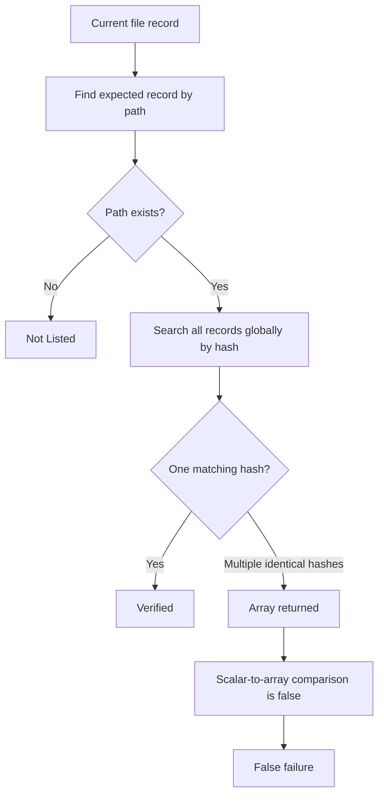

# Duplicate-content files produce false checksum failures

`Test-Verification` incorrectly reports valid files as failed when two or more paths contain identical bytes and therefore share the same SHA-256 hash.

## Status

| Field | Value |
| --- | --- |
| Component | `Test-Verification` |
| Confirmed version | `csverify 0.3.6.0` from `phellams-automator:latest` |
| Severity | High for packages containing vendored or shared files |
| Reproducible | Yes |
| Affected platforms | Platform-independent logic defect |
| Source | `libs/Test-Verification.psm1` |

## Encountered error

The GLVigor module build generated a verification file and immediately tested it:

```powershell
# glvigor repository root
$env:AUTOMATOR_VERSION = 'latest'
./automator-devops/localbuilder.ps1 -Automator -Build
```

Generation completed, but verification reported:

```text
CsVerify generated the verification files
Testing verification files
...
OperationStopped: VERIFICATION failed (18 failed of 192 files)
```

The failed records were nine pairs of files with identical content:

| Duplicate-content group | Paths |
| --- | --- |
| License | `.\LICENSE`, `.\tools\LICENSE.txt` |
| Upper-case helper | `.\helpers\ui\Invoke-UpperCase.ps1`, `.\helpers\uhwriter\Private\Invoke-UpperCase.ps1` |
| Lower-case helper | `.\helpers\ui\Invoke-LowerCase.ps1`, `.\helpers\uhwriter\Private\Invoke-LowerCase.ps1` |
| Terminal background helper | `.\helpers\ui\Get-TerminalBG.ps1`, `.\helpers\uhwriter\Private\Get-TerminalBG.ps1` |
| TUI string formatter | `.\helpers\ui\Format-TuiString.ps1`, `.\helpers\uhwriter\Private\Format-TuiString.ps1` |
| Spacing helper | `.\helpers\uhwriter\Private\Format-StringWithCharSpacesAndHyphens.ps1`, `.\helpers\flowgraph\private\helpers\Format-StringWithCharSpacesAndHyphens.ps1` |
| ASCII gradient helper | `.\helpers\New-AsciiGradient.ps1`, `.\helpers\flowgraph\private\helpers\New-AsciiGradient.ps1` |
| CLAP helper | `.\helpers\clap.ps1`, `.\helpers\flowgraph\private\helpers\clap.ps1` |
| ASCII tokenizer | `.\helpers\asciitokenizer.ps1`, `.\helpers\flowgraph\private\helpers\asciitokenizer.ps1` |

An independent path-bound SHA-256 comparison of every generated record returned:

```text
Records=192 PathBoundFailures=0
```

All files were valid. The 18 failures were false positives.

## Expected behavior

Verification identity must be the normalized relative path. The hash and size are properties of the record at that path.

Two different paths are allowed to have the same hash. Both records must pass when their individual path-bound hashes match the verification file.

## Root cause

The current implementation finds a record by path, then performs a separate global search by hash:

```powershell
# libs/Test-Verification.psm1
foreach ($item in $checksum) {
    if ($item.Path -eq $checksum_verify.Where({ $_.Path -eq $item.Path }).Path) {
        if ($item.Hash -eq $checksum_verify.Where({ $_.Hash -eq $item.Hash }).Hash) {
            # Verified
        }
    }
}
```

When a hash is unique, the second query returns one value and the comparison succeeds. When multiple records share the hash, the query returns an array. A scalar hash compared to that array as the right operand evaluates false, so every member of the duplicate-content group is marked failed.



## Minimal correction

Resolve one expected record by path and compare the current hash directly with that record:

```powershell
# libs/Test-Verification.psm1
$expectedRecord = $checksum_verify.Where(
    { $_.Path -eq $item.Path },
    'First'
)

if ($null -eq $expectedRecord) {
    # Unexpected current file: not present in VERIFICATION.txt
}
elseif ($item.Hash -eq $expectedRecord.Hash) {
    # Verified
}
else {
    # Hash mismatch
}
```

This removes the false failure without prohibiting legitimate duplicate-content files.

## Recommended implementation

Build path-keyed indexes for the expected and current records. Perform comparisons using raw values and add presentation formatting only when writing console output.

```powershell
# libs/Test-Verification.psm1
$pathComparer = if ($IsWindows) {
    [System.StringComparer]::OrdinalIgnoreCase
}
else {
    [System.StringComparer]::Ordinal
}

$expectedByPath = [System.Collections.Generic.Dictionary[string, object]]::new($pathComparer)
foreach ($record in $checksum_verify) {
    $normalizedPath = $record.Path.Replace('\', '/').Trim()
    if (-not $expectedByPath.TryAdd($normalizedPath, $record)) {
        throw "Duplicate path in VERIFICATION.txt: $normalizedPath"
    }
}

$results = [System.Collections.Generic.List[object]]::new($checksum.Count)
foreach ($item in $checksum) {
    $normalizedPath = $item.Path.Replace('\', '/').Trim()
    $expectedRecord = $null

    if (-not $expectedByPath.TryGetValue($normalizedPath, [ref]$expectedRecord)) {
        $results.Add([pscustomobject]@{
            Status       = 'Unexpected'
            Path         = $item.Path
            ExpectedHash = $null
            ActualHash   = $item.Hash
            Size         = $item.Size
        })
        continue
    }

    $status = if ($item.Hash -ceq $expectedRecord.Hash) {
        'Verified'
    }
    else {
        'HashMismatch'
    }

    $results.Add([pscustomobject]@{
        Status       = $status
        Path         = $item.Path
        ExpectedHash = $expectedRecord.Hash
        ActualHash   = $item.Hash
        Size         = $item.Size
    })
}
```

A second pass over the expected index is required to report expected files that are absent from the current filesystem as `Missing`.

## Additional correctness improvements

### Count every failure state

The current failure count only matches the word `Failed`:

```powershell
$failed = $verification_results.Where({ $_.Status -match 'Failed' }).Count
```

`Not Listed` records therefore do not cause the command to fail. Use explicit machine-readable statuses and count every status other than `Verified`:

```powershell
$failed = $results.Where({ $_.Status -ne 'Verified' }).Count
```

### Detect missing expected files

The current loop only visits files found on disk. If a record exists in `VERIFICATION.txt` but the corresponding file was deleted, it is never visited and cannot be reported. Compare both path sets and create a `Missing` result for every expected path absent from the current set.

### Keep data separate from ANSI formatting

`Read-CheckSum` currently applies `Get-ColorTune` to `Size` and `Path`. This places terminal escape sequences in values later used for comparison. It also makes returned objects unsuitable for automation and serialization.

Return raw `Status`, `Path`, `Hash`, and `Size` values. Apply color only in the console renderer.

### Return objects instead of formatting objects

`Test-Verification` currently returns:

```powershell
return $verification_results | Format-Table -AutoSize
```

`Format-Table` produces formatting instructions rather than reusable verification records. Return `$verification_results` directly and let callers choose their output format:

```powershell
Test-Verification -Path './dist/module' | Format-Table -AutoSize
```

### Correct the result property typo

The verified branch in the current repository uses `sath` instead of `path`. Standardize the property as `Path` for every result state.

### Normalize paths consistently

Normalize directory separators before indexing so a verification file generated on Windows can be read on Linux and macOS. Preserve relative paths and define case comparison explicitly:

- Windows: ordinal, case-insensitive comparison.
- Linux and macOS package validation: ordinal comparison unless a compatibility mode is explicitly requested.
- Reject duplicate normalized paths in a verification file.

### Validate parsed records

`Read-CheckSum` should reject malformed records rather than creating partially populated objects. Validate:

- Exactly three fields: size, hash, and relative path.
- SHA-256 is exactly 64 hexadecimal characters.
- Relative path is non-empty.
- A normalized path occurs no more than once.

## Required regression tests

| Test case | Expected result |
| --- | --- |
| Two paths with identical bytes and identical SHA-256 hashes | Both are `Verified` |
| Three or more paths with identical bytes | Every path is `Verified` |
| Same basename in different directories with different content | Each path is compared independently |
| Existing path with modified content | `HashMismatch` and terminating verification failure |
| Current file absent from `VERIFICATION.txt` | `Unexpected` and terminating verification failure |
| Expected file deleted from disk | `Missing` and terminating verification failure |
| Duplicate normalized path in `VERIFICATION.txt` | Parse or validation error |
| Empty file | Verified against the SHA-256 empty-content hash |
| Paths containing spaces | Parsed and verified without truncation |
| Verification generated on Windows and tested on Linux | Separators normalize and records resolve correctly |
| Verification generated on Linux and tested on Windows | Separators normalize and records resolve correctly |
| Caller pipes results to `ConvertTo-Json` | Raw result objects serialize without ANSI or formatting metadata |

## Acceptance criteria

- Duplicate hashes across distinct paths are supported.
- Record matching uses normalized relative path identity.
- Hash comparison is performed against the expected record for the same path.
- Modified, unexpected, and missing files all cause verification failure.
- Every result uses a consistent `Status`, `Path`, `ExpectedHash`, `ActualHash`, and `Size` schema.
- Returned objects contain no ANSI escape sequences.
- `Test-Verification` returns data objects, not `Format-Table` output.
- Pester tests cover every case in the regression matrix.
- The GLVigor reproduction validates all 192 records, including the nine duplicate-content groups.

## API reference

| Member | Type | Required | Default | Description |
| --- | --- | --- | --- | --- |
| `Test-Verification -Path` | `string` | Yes | None | Root directory containing `tools/VERIFICATION.txt` and the files being verified. |
| `Status` | `string` | Output | None | One of `Verified`, `HashMismatch`, `Unexpected`, or `Missing`. |
| `Path` | `string` | Output | None | Relative path used as the record identity. |
| `ExpectedHash` | `string` or `null` | Output | None | SHA-256 value read from `VERIFICATION.txt`; null for an unexpected file. |
| `ActualHash` | `string` or `null` | Output | None | SHA-256 value calculated from disk; null for a missing file. |
| `Size` | `string` | Output | None | Existing display size retained for compatibility; a future typed byte count is preferable. |
